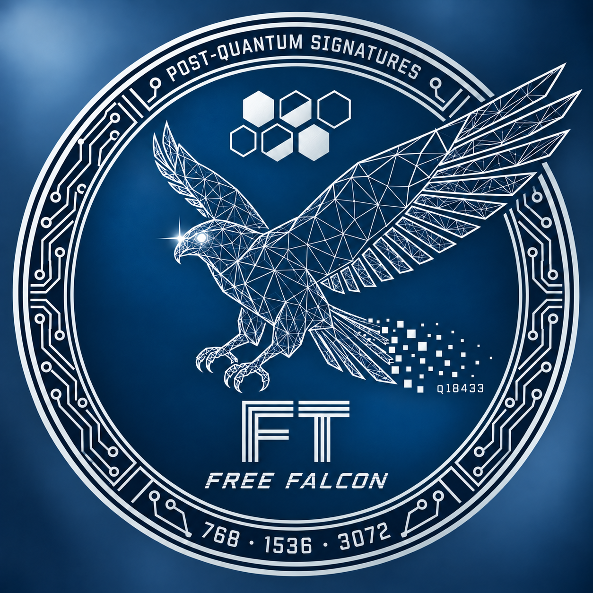

<div align="center">



# Free FT

**Ternary lattice signatures · Source-bound security analysis**

C · Lean 4 · SageMath

[Website](https://niirmataa.github.io/freeft-site/) ·
[Manuscript](proofs/ft1536/paper/) ·
[Proof map](docs/onboarding/PROOF_MAP.md) ·
[Getting started](START_HERE.md)

</div>

---

Free FT is a cryptographic research project by **Niirmata**, developing
**FT1536**, a lattice-signature profile with coefficient-ternary secrets.
It builds on the historical Falcon EXTRA / ternary implementation.

The repository brings together a C implementation, a conditional classical
security reduction, and proofs connecting mathematical objects to source
execution, memory and serialized bytes. The objective is to analyze the
same keys and signatures that the program actually produces.

## The FT1536 profile

$$
R=\mathbb{Z}[X]/(X^{1536}-X^{768}+1),\qquad q=18433,
\qquad f,g\in\{-1,0,1\}^{1536}.
$$

FT1536 is the main research profile. **FT768 and FT3072 remain research
proposals**; FT1536 results do not automatically extend to them. The active
implementation is in [`Extra/c`](Extra/c/), using emulated floating-point
arithmetic and the adaptive scalar sampler.

## Results and current work

*Status snapshot: 21 October 2026 · [source revision `df6c67ac`](https://github.com/niirmataa/free_falcon_sign/tree/df6c67ac889d0f3383bdbb33cdf2d64e34c7245b).*

| Area | Current scope | Details |
| :--- | :--- | :--- |
| **Classical reduction** | Proved conditional EUF-CMA → MT-ISIS reduction, with a concrete reducer and explicit losses. | [Main theorem](proofs/ft1536/development/T12_1/run2/formal/Run2/ConcreteReduction.lean) |
| **Source correctness** | Pinned-model results for verification, codecs, arithmetic and preservation of key material. | [Proof map](docs/onboarding/PROOF_MAP.md) |
| **Whole KeyGen** | Constructive success-witness work is progressing through the NTRU solver and CRT path. The complete witness remains open. | [Work log](proofs/ft1536/development/T12_1/source3/WORK_STATE.md) |
| **Signing and randomness** | Scalar IID analysis is established in its stated domain; full real-Sign and PRG composition remains open. | [Scalar analysis](proofs/ft1536/validation/2026-09-21-scalar-gaussian/README.md) · [Integration notes](proofs/ft1536/development/T12_1/run2/notes/B4_SYNTHESIS.md) |
| **Public sampler — S05** | Conditional distribution certificates and execution counts; full resource accounting and QROM composition remain open. | [Current work](proofs/ft1536/development/S05_QROM/README.md) |

**Research scope.** The conditional reduction is not a completed security
certificate for the deployed C implementation. No QROM security claim is
made. [S06 security estimates](proofs/ft1536/validation/2026-09-22-family-estimator-independent/README.md)
remain uncertified. Review verdicts apply to the stated component and snapshot.

For developments after this snapshot, follow the work logs above and the
[recent commits](https://github.com/niirmataa/free_falcon_sign/commits/main/).

## Build and check

Requirements: Linux, GCC, GNU Make and Python 3.11 or later.

```sh
make FT1536
make check-FT1536
```

The CLI is built at `.build/FT1536/ft1536`. The build checks the pinned
source manifest; `check-FT1536` runs focused arithmetic and verifier
regressions. It is **not** a full Lean replay or an end-to-end KeyGen/Sign test.
See [build provenance and interface boundaries](provenance/FT1536_ACTIVE_BUILD.md).

## Documentation and evidence

The [manuscript](proofs/ft1536/paper/) presents the mathematical argument;
its [source map](proofs/ft1536/paper/SOURCES.md) records the supporting
artifacts. Development checkpoints may be newer than the manuscript.

The [proof archive](proofs/ft1536/) and [validation reports](proofs/ft1536/validation/)
separate kernel-checked statements, analytical arguments and finite tests.
Reports retain their assumptions, source pins, replay instructions and
historical review status.

## Credits and licensing

Research and development: **Niirmata**. Historical implementation:
**Thomas Pornin and the Falcon Project**.

Free FT is dual-licensed under [MIT or Apache-2.0](LICENSE).
See [NOTICE](NOTICE) and individual source headers for inherited components
and attribution.
